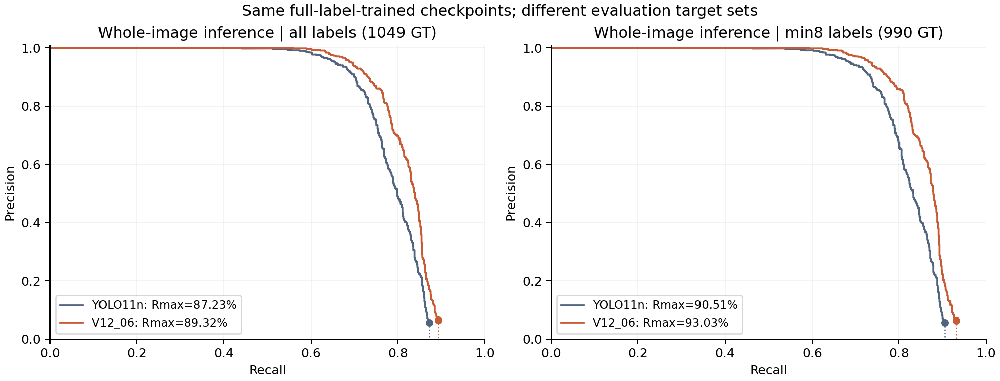

# 柑橘实例分割：证据重核与三因素精简方案

日期：2026-11-12。正式新模型精度尚未产生。本文区分训练内验证峰值、保留权重的最终验证、不同标签集合、不同训练配方。所有新实验限定整图，不切片。

## 1. 结论与核查范围

最新同批全标签比较中，原版 YOLO11n 为 **78.7904 / 62.9855**，V12_06 为 **81.9414 / 65.3320**，依次为 Mask AP50 / AP50–95（%）。提升分别 **3.1510 / 2.3465 个百分点**；Recall 从69.2652至72.1640，+2.8988点。这个增益有原始结果支持，尚不是跨种子、无泄漏测试集上的正式论文结论。

本轮重新读取results中的370份训练CSV与保存参数，356种CSV内容。对366份记录找到当前对应YAML及模块定义路径；另外4份保存的是恢复训练last.pt路径，不能仅凭路径自动恢复原始YAML，已列在未解析清单。原生YOLO11n计算图匹配15个运行目录、14种CSV内容，均为seed42记录；展示副本和相同保留权重不能当作独立重复试验。

这不是声称逐字精读了所有源码。全量建立实验—YAML—模块定义索引，重点核读G10、SAGE V4R/V5/V6、EV10/EV11/EV12、ES精简版、R_MINIMAL，以及训练器、验证器、选best与损失分发路径。当前源码与历史服务器源码并非全部有完整快照；对应文件存在不等于历史实现完全相同。

最新V12有19个模型、38个训练CSV；37个记录到300epoch，P08的min8分支仅64epoch。最终指标74行，18个模型具有完整四格对照，P08仅有all训练的两种评估。原计划中的P09/P10在此目录尚无回传，不把旧批次同名分数补进本批。

## 2. 基线为什么会有78、83.1、83.25

| 来源与口径 | Mask AP50 | Mask AP50–95 | 正确解释 |
|---|---:|---:|---|
| 早期001_3原版，实际best记录 |78.635|62.076|早期历史配方成绩 |
| 最新ES00，全标签训练→全标签最终评估，1049GT |78.7904|62.9855|本批V12的对应基线 |
| 同一个ES00，训练内epoch266，min8验证选best |83.151|66.967|训练内过滤标签验证，不是全标签最终分数 |
| 同一个ES00，独立最终min8评估，990GT |82.0977|65.9485|过滤标签后的另一评测任务 |
| 历史G0830/G00官方原版，实际best记录 |83.250|67.031|另一个初始化/AMP/增强等协议下的原版成绩 |

因此两种“83分”都可能是真的，但必须带运行和协议。当前最新78.7904与83.151已经可以在同一训练目录中解释；历史83.25则是另一批基线。不能仅凭AMP=true/false把全部差异归因为数值精度。参数pretrained=True本身也不能证明权重实际加载，显式加载与元素相等记录更可靠。

新R实验统一用正式分组数据、显式官方预训练、AMP=False、mask_ratio=2、全标签选best，因此新的原版结果要重新测，既不承诺78，也不承诺83。不要为了制造大涨幅选较弱历史基线比较新强配方。

原始定位：V12/ES00_baseline/LABEL8_RESULTS.csv；train_all_seed42/results.csv及best_mask_selection.json；G0830/G00_official_control/weights/best.pt。已重新加载可用原版权重核对train_metrics；J/v1/J00的best.pt在本地读出zip目录损坏，保留CSV证据，不冒充完成权重验证。

## 3. V12到底到83还是85，以及谁最强

| 同为全标签训练 | 最终评测GT | Mask AP50 | Mask AP50–95 | Recall |
|---|---:|---:|---:|---:|
| ES00，all评估 |1049|78.7904|62.9855|69.2652|
| V12_06，all评估 |1049|81.9414|65.3320|72.1640|
| ES00，min8评估 |990|82.0977|65.9485|72.6585|
| V12_06，min8评估 |990|85.9617|68.8138|76.4646|

同min8评估的V12_06增益为AP50 +3.8639、AP50–95 +2.8652。85.9617减78.7904不构成合法的结构增益。旧E12约84–85的其它记录还涉及切片训练/推理或更强训练配方，本报告不将它们并入无切片结论。

当前同协议首选精度候选是V12_06。按历史整图训练/整图验证的最高Mask AP50–95记录，YOLO11改进中G10的保留best为83.824/67.681，3.214M、14.538G；SAGE42保留best为82.982/67.502，2.319M、10.042G，是值得保留的精度—成本候选。G10不是最新同协议胜者，不可与78.7904直接相减归因。更大的YOLOv9c参考AP50–95达68.173，但约27.9M参数，不符合nano级预算。

V12_06为2.284M、10.644G，原版2.843M、10.356G。它确实少参，FLOPs略高；不要把少参自动写成更快。历史最高、同协议最强、实机最快是不同判据。

## 4. min8是否值得作为主数据集

建议保留完整既有标签，统一使用 **orange_yolo_grouped_dedup_20260820**。此次不修改、删除任何原始图片或标签。

最新回传实际使用旧orange_yolo，train4324、val1049个实例；过滤后train4035、val990。正式分组版为676/193/96图、4120/1181/589实例，成员划分不同。不能把两者的分数混用。新入口只接正式分组版，并将同一份全标签用于训练、验证选best和最终验证；test保持封存，未参与新模型选择。

min8是删除按长边640等比缩放后外接框短边<8的多边形标签，图像中的果实仍在。这会改变训练目标与评测任务，不等于修正错误标注，也没有把被删除区域设为ignore。

18组配对在同all评估中，min8训练的AP50–95均值变化+0.2255点，中位数+0.1909；Recall均值−0.0409、中位数−0.6392。它们是相关模型上的描述统计，不能当18个独立重复实验。V12_01的评估异常使均值偏高，排除它后17组AP50–95均值仅+0.0839、Recall−0.3077。

原版min8训练在all评估中AP50–95+0.5423，但V12_06下降1.0521、Recall下降0.7065。这些数据不支持“删除小果标签普遍更好”。对于套袋任务，若确有最小可操作果径，应依据标定/物理尺寸预先定义任务，不能事后以8像素获得较高AP来决定。

旧Y11_LABEL8的all/min8和min8/min8均报告1049GT，最后一行还复用了all/all数值。不能采信其min8结论。根因需要当时服务器文件/缓存才能确认，本地不能编造是哪一环造成。

## 5. 哪些改动值得保留

| 方向及直接对照 | 最新/历史证据 | 判断 |
|---|---|---|
| ES02仅语义校正 vs ES00 |all AP95 +1.0273，Recall +3.4708|当前最清楚的单改动正向线索，优先复验 |
| ES01仅浅层掩膜细节 vs ES00 |all AP95 +0.5500，Recall −0.0564|min8训练对照时AP95还低于原版；有条件的小收益 |
| ES03细节+语义 vs ES02 |all AP95 −0.3793|没有协同单调增益，不应机械叠加 |
| V12_03→V12_06，入口对比度改变 |all AP95 +1.4039|该母体上的强线索，需要在简单母体单独复验 |
| V12_04→P02，去持续细节 |all AP95 +0.5599|目前不能证明持续非对称双流必要 |
| V12_04→P06，简化上采样 |all AP95 +1.0024|复杂重组不是必需；不能将其收益直接移到V12_06 |
| V12_04→P05，恢复完整PAN |all AP95 −0.1993|可保留非对称颈部节省成本，精度差较小 |
| SAGE30→40，非对称颈部单改动 |旧同批AP95 +0.144，减少约0.527M参数|成本方向合理；精度并非已经大涨 |
| SAGE30→42，非对称颈部+语义掩膜细节 |旧同批AP95 +0.783|值得同协议复跑的整体候选 |
| V12_04→P07，关边界辅助损失 |all AP95 +0.0979|没有稳定必要性证据 |
| V12_04→P08，关邻域辅助损失 |all AP95 +0.6947，仅all分支完成|保留负证据；不凑辅助损失创新 |

“非对称颈部”“持续细节流”“双主干”不能混称。R_MINIMAL的A为非对称颈部；B是窄C2→P3 relay；没有第二套RGB/灰度骨干。ES02为语义特征校正；YOLO的mask prototypes是可学习掩膜基底，不等于强制果实圆形/凸形的显式先验。形状/边界思想有研究价值，但现有删除试验不支持多项先验都必要。可见掩膜本身可因叶片遮挡而深凹，不宜直接向凸包或圆形拉齐。

### 进一步反证：模块贡献随训练标签变化

固定最终all评估，仅分别考察两种训练标签下的相同模块对照：

| 对照 | 全标签训练ΔAP95 | min8训练ΔAP95 |
|---|---:|---:|
| ES02−ES00，语义校正 |+1.0273|+0.0004|
| ES01−ES00，细节路径 |+0.5500|−0.2609|
| V12_06−V12_03，对比度入口 |+1.4039|+0.0296|
| P02−V12_04，去持续细节 |+0.5599|−0.7368|
| P06−V12_04，简化上采样 |+1.0024|−0.4776|

这说明设计与监督任务存在交互，不能以“去掉某模块一次涨了”宣布它永远没用，也不能将正向结果当普遍规律。尤其不能先选min8数据，再直接沿用全标签实验的模块排名。单seed、模型初始化的随机性和部分评估异常仍可能影响上述差异，未证明小果本身是交互的唯一原因。新方案明确固定全标签，仅把三个方向列为可否证假设。

## 6. 数据与PR问题的定位

最新V12_06在all验证的Mask IoU=0.5最大观测召回为937/1049=89.3232%，仍有112个GT未匹配；旧验证集中<8px的GT只有59个。因此即使59个微小果实全部漏掉，仍至少有53个漏检GT短边≥8px。这个下界直接否定“所有漏检都是<8px造成的”，但不能单凭它归因为颜色混淆。ES00相应为915/1049，134个未匹配，至少75个≥8px。

在观测曲线上要求Precision≥90%时，ES00最大Recall为69.9714%，V12_06为73.2126%，提高3.2412个百分点。相应仍约有315和281个未召回实例。这比关注人为补齐的零值尾段更直接地说明可用工作点的识别能力与剩余空间；阈值是验证集诊断，不能在测试集重新挑选。

正式数据既有诊断显示：训练/验证约20%的实例短边<16px；验证104/1181短边<8px；灰度CNR<1约72%；验证117个实例solidity<0.8，387个实例在2px邻域有其它标注实例。CNR只是灰度对比代理，solidity只是凹形代理，邻域只是接触风险代理，均不是已验证的颜色混淆/遮挡/split-merge错误标签。8px精确阈值以Decimal审计为准，旧浮点统计训练234与精确233的差异来自边界计算，不重写标签以迎合数字。

本轮依据现存split_manifest重新核算303组，old_split跨组123、new_split跨组0，且旧成员路径均存在，详见domain_audit.json。按清单cohort，正式val的camera_2026有168图/794实例，其中97个<8px；camera_2023有25图/387实例，其中7个<8px。因此删除小目标主要排除了某个相机来源的困难实例。训练有3张清单标注ai_generated图、29张video图，验证/测试清单无这两类；来源标签沿用现有元数据，未自行判定图像真假。原始成员全部保留。

不要把总体AP提高自动解释成跨来源提高。后续在同一固定val/test内部按来源、短边、低对比代理做分层报告，并单独审视camera_2026的小果召回。分层应沿用同一套预测和完整匹配，不能随意删掉其它GT制造FP。不能用这些观察重新按结果挑选测试集。

读图IMG_0221可见果实与叶片颜色相近、遮挡和接触关系；这个例子不能代替困难子集统计。灰度是RGB的确定性函数，没有凭空增加传感器信息；它只是另一种归纳偏置，必须保留原RGB路线验证是否有益。

当前metrics.py:769–770在最大可达Recall处及Recall=1处追加Precision=0。故末端垂直归零包含插值补零成分，并非“置信度85%时模型全部失效”。横轴是Recall。

原始观测曲线中，ES00 all Rmax=87.226%、R@P90=69.971%；V12_06 all Rmax=89.323%、R@P90=73.213%。min8下分别Rmax90.505%与93.030%，仍未100%。真正应改进的是可达召回和高精度工作点的召回，而不是把补零线画掉。

图中实线来自保存的原始阈值点，实心点标最后可达位置，虚线示意补零，不改AP计算。



还有一处待核验：V12_01的all/min8原始预测总数由末点TP/precision还原为13279/13832，ES00为15913/15755，而V12_06均为14299。列表长度只是不同置信度组数。不能将所有分差说成纯GT删除的效果；需共同权重、图像字节、顺序、batch、预处理及精度复评。新入口已统一rect=False、FP32验证、固定数据，并检查最终目标数与选best目标数一致。

## 7. R_MINIMAL审查与三个候选因子

R_MINIMAL已具备模块导出、parse_model注册及原生损失路径，四组图定义能独立切换A/B。零初始化relay保持初始函数，gain先更新、内部参数随后获得梯度是预期；不能据第一步内部梯度为0判断失效。它新增的传递路径尚无正式精度支持，命名不能作为创新证据。原R00–R03完整保留，本次不覆盖。

新方案目录 **R_EVIDENCE_series**，仅使用三个可隔离因素：

- A：去掉最后P4→P5颈部重建，P5预测读取原骨干C5，保留P3/P4融合与预测尺度。
- B：保留RGB stem，在入口加入已有EV10局部灰度对比残差，只有192个额外参数；不是双主干。
- C：复用已在ES02出现正向结果的P3/P4语义校正，作用于框/分类/系数预测特征；原Proto仍读未校正P3。不是显式mask prior，也不是把门控当可靠概率。

保持标准C3k2主干主体、原生候选塔、原生掩膜分辨率和原生损失；不添加高分辨率候选塔、持续双流、质量重评分、边界/邻域/tiny-Dice辅助项。三个因素是现有方法的任务化收敛组合，并非三个全新算子。能否成为论文方法由后续证据决定。

局部对比定义与实现一致：

$$g=0.299R+0.587G+0.114B,\quad z=\tanh\frac{g-\mu_7(g)}{\sqrt{\max(\mu_7(g^2)-\mu_7(g)^2,0)+0.05^2}}.$$

$$F_0=\operatorname{Conv}_{RGB}(I)+\tanh(\alpha)\odot\operatorname{Conv}_{gray}(z),\quad\alpha_0=0.$$

在窗口亮度加常数的理想假设下，去局部均值会抵消该常数；方差下限和tanh抑制平坦区域数值放大。但这不保证对颜色、阴影和叶片纹理不变，也不能证明AP必升。

语义校正用局部投影m、上层参考r、局部均值l构建差异e=r−l和细节h=m−l，通过门控和窄卷积得到修正T，输出为F'=F+0.5 tanh(β)⊙T。β零初始化保证起点函数一致，且逐点有|F'−F|≤0.5|T|。这只是残差相对幅值上界，T本身不受该式统一约束，不能包装成闭环稳定性证明。

8组2³全因子能估计A、B、C的单独收益与交互。例如固定C=0时，AB交互为m110−m100−m010+m000。只跑Baseline→A→AB→ABC不能排除顺序依赖。若C只有在B存在时有效，应报告条件性协同；若某项无效就删去，不强凑三大创新。

## 8. 文献怎样影响设计

本轮提取本地FreqFusion、Lite-HRNet Plus、WaveDH的PDF及51页创新指南、YOLO.docx，重点读摘要/结构/方法段；联网核对TOOD、PIDNet、DGNet与FreqFusion原始论文。没有声称读完全部论文库。

- [FreqFusion，TPAMI 2024](https://arxiv.org/abs/2408.12879)：融合要同时考虑目标内部一致性与边界位置，不能只把高频增强当小果解决方案。借鉴问题分解，未复制其ALPF/offset/AHPF三模块。
- [DGNet，Machine Intelligence Research 2023](https://arxiv.org/abs/2205.12853)：伪装目标的纹理与上下文可以分工。这里压缩为入口补充证据；不移植完整双编码器，也不宣称普通COD结果直接证明柑橘实例分离。
- [TOOD，ICCV 2021](https://openaccess.thecvf.com/content/ICCV2021/html/Feng_TOOD_Task-Aligned_One-Stage_Object_Detection_ICCV_2021_paper.html)：分类与定位的特征需求及对齐需要实证。已有YOLO分配已借鉴TAL，不能再把TAL当原创；本次测试已有语义校正是否值得保留。
- [PIDNet，CVPR 2023](https://openaccess.thecvf.com/content/CVPR2023/html/Xu_PIDNet_A_Real-Time_Semantic_Segmentation_Network_Inspired_by_PID_Controllers_CVPR_2023_paper.html)：细节/上下文融合存在相互压制风险。但本项目的feed-forward残差没有积分状态，不称PID控制器。
- [Lite-HRNet Plus，ICIP 2023](https://arxiv.org/abs/2308.12133)：多分辨率融合本身有明显成本，支持先核算融合预算。人脸关键点证据不等于柑橘分割收益。
- [WaveDH](https://arxiv.org/abs/2404.01604)：小波引导重建服务于去雾，当前缺少把整套结构移入柑橘识别的直接证据，暂不采用。

创新指南提供组合启发，不提供对当前数据的有效性证明；“A+B+C即可发论文”不能作为结论。新颖性还需系统近邻比较、机制诊断及可靠测试结果。

## 9. 如何跑、怎样收敛

入口 **RUN_R_EVIDENCE.py** 可在VS Code直接运行，前台按顺序一个模型一个进程，不用nohup，不开GPU占用阻拦。默认RUN_MODE="reference"，先统一跑RE00、REF_V12_06、REF_SAGE42。将RUN_MODE改为"factorial"运行8组，"all"则10组；各模式默认输出目录不同，避免覆盖。

统一正式分组全标签数据，640整图、seed42、300epoch、batch16、workers4、cache=True、AMP=False、显式yolo11n-seg.pt初始化、AdamW lr0=.001/lrf=.01、weight_decay=.0005、mask_ratio=2、dropout=0、copy_paste=.3、mosaic=1、close_mosaic=10、patience=0。验证统一EV6 input/2、rect=False、half=False、conf=.001、iou=.7、max_det=300。这些是明确的新共同配方，不是复刻78配方。

8个RE组全用原生损失。两个REF组保留其头部固有损失，是整体方法参照，不算结构单因素。运行保存实际数据成员/标签哈希、加载数量、初始化迁移、源码指纹和配方，只有路径与审计不一致才报错，没有人工确认门禁。cache为RAM时仍需三seed检验训练波动。

```bash
cd /data/sxq/code/ultralytics-main-new
/home/amax/sxq/bin/python RUN_R_EVIDENCE.py
```

正式前可运行 --smoke --device 1 --workers 0 --batch 2。训练完看FULL_LABEL_RESULTS.csv；8组完成后运行ANALYZE_R_EVIDENCE.py对应结果目录，生成FACTOR_CONTRASTS.csv。其输出是同seed差值，不冒充统计显著性。

新统一数据下先确认原版与两候选。若新方案同时被原版或现有候选在精度和实测速度上支配，就停止扩展。只把稳定赢家与原版补seed43/44，最终报告均值±标准差、固定工作点Recall、尺度/低对比/接触代理子集，人工核查错误，再做封存test和外部泛化。已知历史划分有组间泄漏风险，当前单seed探索成绩不足以保证期刊录用。

## 10. 已完成验证与限制

10个模型均完成640前向与GFLOPs统计、显式预训练迁移检查；8个RE组原生损失反传、零起点等价、残差激活后梯度与Conv-BN融合检查通过。原R_MINIMAL兼容检查通过。全部10组在CPU四张训练图/四张验证图上实际完成1epoch训练及最终评估，输出完整10行；这些小样本分数没有科研含义。Windows CPU检查不代表Linux CUDA AMP数值或部署延迟已测。

最终验证人口检查新增单测，已用10份smoke运行记录核对目标数；原始结果及标签均未更改。独立评审为partial / medium，same-family / provisional，支持有限探索，未批准把三因素直接写成已经证明的论文贡献。

## 11. 最新全标签同批完整表

下表全为train=all、eval=all、val、seed42、整图，best由min8验证选出，这一点仍限制当前结论。AP单位%，差值单位百分点。

| 模型 | Mask AP50 | Mask AP50–95 | Recall | AP50–95相对ES00 |
|---|---:|---:|---:|---:|
|V12_06_recognition_contrast|81.9414|65.3320|72.1640|+2.3465|
|V12_00_contrast_anchor|80.2708|64.6175|72.1640|+1.6320|
|P06_bilinear_only|80.7032|64.5655|73.2126|+1.5800|
|P08_no_neighbor_loss|80.2877|64.2578|70.9247|+1.2723|
|V12_02_persistent_anchor|79.5716|64.1935|68.8003|+1.2079|
|P02_no_persistent_detail|80.3643|64.1230|71.7827|+1.1375|
|V12_08_sum_evidence_control|80.1037|64.1170|71.9733|+1.1315|
|ES02_semantic|80.1556|64.0128|72.7359|+1.0273|
|V12_03_recognition_route|80.1906|63.9281|71.0200|+0.9426|
|V12_05_recognition_lite_box|79.9383|63.9210|73.3079|+0.9355|
|V12_09_without_tiny_dice|79.8341|63.8996|69.9714|+0.9141|
|P07_no_boundary_loss|80.0371|63.6610|70.1982|+0.6755|
|ES03_detail_semantic|79.8117|63.6335|71.4967|+0.6480|
|V12_04_shared_route_control|79.1971|63.5631|71.2803|+0.5776|
|ES01_detail|79.0552|63.5355|69.2088|+0.5500|
|V12_07_head_detail_route|79.7715|63.5295|71.6816|+0.5440|
|P05_full_pan_neck|79.1299|63.3638|72.2593|+0.3782|
|ES00_baseline|78.7904|62.9855|69.2652|+0.0000|
|V12_01_detail_anchor|76.1489|61.1504|67.0510|-1.8351|

## 12. 本轮实际构建成本

THOP/Ultralytics同一统计口径，640输入；未完整计入逐元素、池化及访存成本，以服务器实测为准。

| 模型 | Params/M | GFLOPs | 官方预训练参数元素相等比例 |
|---|---:|---:|---:|
|RE00_baseline|2.842803|10.3558|98.45%|
|RE01_asym|2.316211|9.9326|98.10%|
|RE02_contrast|2.842995|10.3984|98.44%|
|RE03_semantic|2.856949|10.4195|97.96%|
|RE04_asym_contrast|2.316403|9.9752|98.09%|
|RE05_asym_semantic|2.330357|9.9964|97.50%|
|RE06_contrast_semantic|2.857141|10.4621|97.96%|
|RE07_full|2.330549|10.0390|97.50%|
|REF_V12_06|2.284142|10.6439|91.54%|
|REF_SAGE42|2.319092|10.0416|97.98%|

完整RE07相对原版参数−18.02%、GFLOPs−3.06%。少参不证明更快，归一化和细小算子可能受访存限制，尤其应检查B的实际耗时。

## 13. 证据文件

- E:/mastercode/_work/evidence_20261112/inventory.json：全370份CSV与协议。
- result_code_matrix.csv：366条当前YAML/模块定义映射与4条恢复路径待确认。
- latest_all_policies.csv：最新74行；四个latest_*.csv按训练/评估标签分开。
- baseline_graph_matches.json、retained_baseline_metrics.json：原版图匹配与权重内指标。
- curve_source_checks.json：74条目标数/最大召回来源一致性。
- min8_train_effect.csv：18模型同评估口径训练标签差值。
- direction_label_interactions.csv、domain_audit.json：模块×训练标签的交互与来源/分组审计。
- preflight/MODEL_COSTS.json、integration_SMOKE/FULL_LABEL_RESULTS.csv：真实工程检查。
- reviewer.md：独立证据审查，局限与后续条件。
- evidence_precheck.json保留数字边界匹配器对CSV逗号的保守false-negative；evidence_precheck_rows.json以原始完整CSV行核对，6项verified。数字同时由CSV解析核对，不把机械匹配视为因果证明。

原始路径分别位于1_SEVER/results/V12、Y11_LABEL8_20261107、G_series、SAGE、G0830等。所有报告只写新增派生产物。
