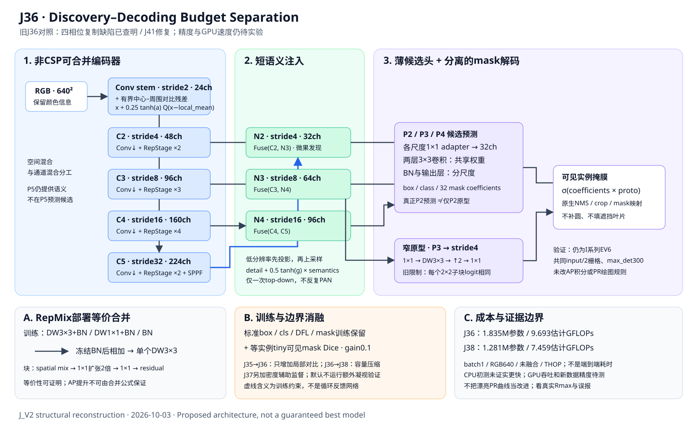

# J_V2：从历史反证出发的结构性重构

日期：2026-10-03。状态：实现与工程验证；**没有新的真实数据训练结果**。

## 结论

本轮不再把“高分辨率原型”“新注意力”当成小果召回的充分条件。
核心方案是 **可合并的非 CSP 编码器 → 短语义—细节解码路径 → 薄 P2 候选发现 → 分离的低成本掩膜生成**。
RGB 始终保留；局部对比只做可撤回的残差，不能宣称已经解决果叶混淆。

保留原 J20–J27 的 8 个一瞥—凝视对照和 J29–J40 的 12 个原结构图，追加 J41–J44 四个针对性解码修复。
现在共有24个YAML，其中16个结构臂；没有删除旧代码、结果、标签。
默认只运行6臂、50 epoch。所有模型保持 I 系列原生 EV6Validator。

**深化审查发现并纠正了前版的两个缺陷**：旧窄原型的 nearest×2+1×1 绑定四个子像素；
共同input/2重建使stride4原型没有降低实例mask重建面积。详见 [DEEP_REVIEW.md](DEEP_REVIEW.md)。
旧J36保留为负对照，不把工程修补描述为已证实的涨点或新原创算法。

## 1. 历史证据重新对齐

重新运行 `scripts/audit_sage_history.py` 和 `scripts/build_citrus_j_evidence.py`。
修改架构前的快照覆盖 **311 份 CSV、297 份去重记录、485 份 YAML**，无解析错误；所有结果均找到当前同名 YAML 候选。
这是全量表格和图结构索引，不等于逐行审计过每个历史源码版本。
深读重点：J 的整个编码器/融合/损失，I20 的持续细节支路与候选头、EV11 特征交换，EV6 数据与验证，
原生 Segment/Detect、TAL 和 PR 指标；对历史优劣不能仅凭文件名推断精确训练版本。

数据索引：`history_unique_runs.csv`。重复 CSV 不是独立重复实验；历史旧划分不能与正式 grouped_dedup 混排。

### 同一 J 组的反证

以下 AP 为 results.csv 中 **mask AP50–95 最大行**，不是独立抽取每一列的最高值。
300 epoch、seed42、scratch、AMP=False、640、旧服务器 `orange_yolo` 成员、原生 EV6 口径。

| 模型 | Mask AP50 | Mask AP50–95 | 同行Mask R / P | 证据含义 |
|---|---:|---:|---|---|
| J00 YOLO11n | 80.338% | 65.689% | 70.639% / 92.797% | 本组对照，不是最早 AMP=True 的 78 分基线 |
| J01 I20 图结构锚 | 81.086% | 66.656% | 72.545% / 90.435% | +0.967 点 AP；值得保留，不足以证明大突破 |
| J02 紧凑对照 | 约77.5% | 约61.7% | 见全量CSV | 压缩容量损失超过所得轻量收益 |
| J03–J10 | 约76% | 约60–60.5% | 见全量CSV | 相位/灰度/场景/融合/上下文组合没有追回容量损失 |
| J11 | 未跑完整300轮 | 仅193轮记录 | 不作完成比较 | 不得称最优或当完成实验比较 |

J00/J01对应epoch277/287。R/P是该epoch验证器选择工作点的值，不是共同固定conf下的召回，
也不是最低阈值的Rmax；J01召回上升伴随精度下降，不能只报前者。

I00/I05 历史 AP 为72.363%/72.477%；双原型差别只有0.114点、单seed，并无稳定大涨证据。
G10/F14/SAGE 的优点保留在历史重放与当前 I20 锚中，但 AMP、初始化、样本成员的混杂不能忽略。

同权重切片证据比跨模型峰值更接近因果，但仍只能归因到整个切片管线：

| 权重/视图 | tiny匹配（/161） | Mask AP50–95 | 保存的中位耗时 |
|---|---:|---:|---:|
| I20 global | 25 | 66.72% | 137.70ms |
| I20 fine + trustedmask | 84 | 75.69% | 417.48ms |
| V12_04 global | 33 | 68.61% | 93.86ms |
| V12_04 fine + trustedmask | 97 | 78.31% | 338.72ms |

这里 tiny=共同640栅格可见mask面积<256、score≥0.25、maskIoU≥0.5；**不是 COCO AP_S**。
AP 为该 paired 脚本共同栅格口径，不能与训练 CSV 或原图 COCO AP 混用。
这支持“分辨率分配值得做”，也明确显示全切片约3倍以上耗时；不能只保留涨点而隐去速度代价。

## 2. 当前任务并不只有颜色

正式数据：676/193/96张，train/val实例4120/1181。既有只读连续几何审计显示：
val框短边<8输入像素104个，<16像素243个；静态640下当前TAL候选区域扩张后所有GT都有资格中心。
因此“没有网格中心所以完全没有正样本”不是当前实现的充分解释。需要追踪增强后的实际分配和最终匹配。

必须同时区分远距小完整果、遮挡后的薄片可见果、接触果实。数据中的深凹轮廓是真实可见标签，
不能用补圆、凸包或单连通惩罚把遮挡叶片填成果实。solidity与间隙是代理，不是人工遮挡/粘连真值。
灰度也不能增加RGB本来不存在的信息；作用假设是改变归纳偏置，而不是“灰度一定更重要”。

## 3. PR问题：处理证据，不处理外观

PR横轴是 **Recall，不是Confidence**。`compute_ap()` 给不可达召回区间添加零精度端点，
这不是证明“0.85置信度后网络崩溃”。本轮完全没有改该函数或正式AP积分。

历史 J00 的额外 observed PR：Rmax=0.8770、R@P≥0.90=0.7083；最低conf≈0.001时仍有129个GT未匹配，
实际端点精度约0.0599。J01对应0.8923/0.7359、113个未匹配。
**注意历史额外诊断可能使用较低max_det或普通验证器栅格，这些不是训练验证器的独立重评结果。**
本轮修正 J2 额外诊断为 EV6+Diagnostic 组合、max_det=300、input/2栅格，并明确默认关闭额外遍历。

后续应看真实观察到的 Rmax、P≥0.90下R、tiny匹配/误报，而不是强求所有PR曲线延伸至R=1。
召回提高但叶片误报暴涨，同样不算成功。

## 4. 结构与消融



上图是旧J36，而不是最终最强网络。其窄原型的复制限制见下表修复及深化审查。

| 臂 | 改动/对照 | 默认首轮 |
|---|---|---|
| J20 | 原 YOLO11n graph，scratch，同数据同训练 | 是 |
| J29 | 原 I20/J01 graph 锚，scratch；不是历史权重复放 | 是 |
| J30 | 全非CSP可合并主干 + PAN；容量与成本对照 | 否 |
| J31 | 同主干 + 单次向下细节残差融合，P3/P4/P5 | 否 |
| J32 | P2/P3/P4真实候选 + 普通高分辨率原型 | 否，成本很高 |
| J33 | J32 + 局部对比残差 | 否，成本很高 |
| J39 | J32 + 窄原型解码器 | 否 |
| J40 | J39 + 共享头卷积，仍stride2原型 | 否 |
| J34 | J40联合改变原型来源P2→P3与输出stride2→4，保留P2候选 | 否 |
| J35 | J34 + 等实例、权重上限2的tiny Dice，gain=0.1 | 否，归因用 |
| J36 | J35 + 零初始化有界局部对比支路 | 是 |
| J37 | J36 + 密度辅助监督，gain=0.1 | 否，凝视扩展用 |
| J38 | J36较窄容量版本，其他设置一致 | 否 |
| J41 | J36仅解除窄原型四相位复制；同初始化函数、同P3来源/stride4 | 是 |
| J42 | J41联合改为P2原型来源与stride2输出；不是纯stride消融 | 是 |
| J43 | J42缩窄主干—颈部通道预算，头部超参数和loss相同 | 是 |
| J44 | J38仅解除复制；较窄图的解码器单项对照 | 否 |

主干：24→48→96→160→224通道，stride2/4/8/16/32；2/3/4/2个非CSP残差混合块。
J38为24→40→80→128→192。P5仍参与语义上下文，**只是主候选头不放在P5，不是P5无用**。
颈部：C5→N4(96ch)→N3(64ch)→N2(32ch)的短路径，融合先在低分辨率投影再放大；没有反复PAN往返。
头部：P2/P3/P4独立候选；两层空间卷积共享，BN分尺度；原型从P3生成stride4输出，
原生验证仍把logit映射到共同input/2栅格。J40/J34联合测试原型来源和分辨率，不能归因成单项stride变化。
“共享头”还同时合并分类/框/系数任务特征与缩窄隐藏通道；J39/J40不能单独证明跨尺度共享的作用。

这些“改动”是实验假设，不是已经证实的论文创新。Rep融合、P2、Dice和中心—周围对比本身均有先例，
论文贡献须落在任务机制、结构取舍、预算—收益证据，而不是改名后宣称首次。

## 5. 成本与不利结果

THOP，batch1、640、FP32，未融合，卷积/BN估计；元素运算/插值/后处理及实例mask重建不完整计入：

| 模型 | Params | GFLOPs |
|---|---:|---:|
| J20 | 2.843M | 10.356 |
| J34 | 1.834M | 9.555 |
| J36 | 1.835M | 9.693 |
| J38 | 1.281M | 7.459 |
| J32高分辨率原型对照 | 2.275M | 27.583 |

J36参数下降约35.5%，估计FLOPs下降约6.4%；J38约54.9%/28.0%。
**本地CPU初测并未证实更快，单独重测J36/J38仍慢于对照**；CPU也没有锁温度/频率，因此GPU速度必须实测。
不能承诺“低GFLOPs就不会慢”。J32等昂贵臂从默认队列移出；实验完整性不应逼你先跑高成本消融。

`scripts/profile_citrus_j2_structure.py` 可在服务器测前向，但最终论文仍需记录整个输入→候选→mask/NMS/合并时间，
以及训练/验证分别的每轮时间和峰值显存。
**纠正**：stride4降低原型生成项，但标准loss及EV6先把原型插值到input/2，
并没有降低每个实例的系数×原型重建面积。该核心项在640下仍是32×320² MAC/实例。

## 6. 数学能保证哪些性质

详见 [MATH.md](MATH.md) 和 `scripts/verify_citrus_j2_math.py`：
冻结BN后的线性分支精确合并；中心—周围算子对常量偏置的抵消；融合输入层的残差上界；
投影前移的空间计算节省；共享卷积仅减少参数、不自动减少MAC；小方形mask的位移敏感性。
不声称Transformer/CNN已被完全解释，也不把代数恒等式当作涨点、泛化或训练稳定性的证明。

## 7. 固定协议与如何跑

入口：主代码根目录 `RUN_CITRUS_J2.py`。编辑 DATA 为你服务器的清洗数据yaml；DEVICE填物理卡号。
不检查划分确认、不要求指纹口令、不检查GPU占用；记录真正载入成员用于事后审计。
默认`SUITE='mechanism'`、`EPOCHS=50`、seed42，顺序J20/J29/J36/J41/J42/J43。
原`priority`五臂仍可显式选择；筛选后改300、选 `ONLY` 并使用新PROJECT，最终三seed。

```bash
cd /data/sxq/code/ultralytics-main-new
python RUN_CITRUS_J2.py
```

也可直接在VS Code选原环境，点击右上角“运行Python文件”。当前进程前台顺序执行、Ctrl+C停止队列；不是nohup。
需要16结构臂时`SUITE='structure'`；仅四个修复臂时`SUITE='decoder_repairs'`。
不建议第一次`all`24臂，它还有昂贵原型与960/1280对照。

640臂固定：cache=True、AMP=False、AdamW、lr0=.001/lrf=.01、batch16、workers4、weight_decay=.0005，
mask_ratio2、copy_paste.3、imgsz640、dropout0、scratch。新主干不混用部分预训练；J20/J29也scratch。
后续“预训练→学生蒸馏”需单列训练方法对照，不能偷偷在最终臂加入。
保留960/1280旧高分辨率对照的cache关闭例外，防止约22/39GiB仅RGB缓存耗尽24GB主存；它们不在默认队列。

训练每epoch EV6原生验证，conf=.001、iou=.7、max_det300、half=False；保存Box/Mask PR、P/R/F1和混淆矩阵。
保留官方box+mask fitness的best.pt，另存best_mask.pt和best_mask50.pt，分开记录，不悄悄改选模标准。
`GAZE_EVAL=False`与`DIAGNOSE_PR=False`默认避免额外十几策略遍历；二者均是附加诊断，不替换训练验证。
额外凝视自定义评估不是原生训练AP，不混列；oracle只作上限，不算可部署方法。

## 8. 判定与下一步

1. 先J20/J29确认同协议锚点；新正式数据分数不必复现旧服务器数字。
2. J36/J41首先检验同来源的原型表达修复；若无收益，不掩盖该负结果。
3. J41/J42检验细尺度来源与输出的联合收益，J42/J43检验通道预算；如果压缩伤精度，停止进一步压缩。
4. 首轮胜出才做J35/J40/J44等归因；50轮筛选不宣布300轮或论文结论，最终三seed和冻结test。
5. 若主结构仍不胜锚点，承认假设被否定，转向有证据的原图分辨率分配/跨尺度蒸馏；不继续叠注意力。

参考综述与来源取舍见 [LITERATURE.md](LITERATURE.md)，实测与未解决风险见 [VERIFICATION.md](VERIFICATION.md)。
文献决策概念图见 [evidence_map.png](evidence_map.png)，不是精确网络计算图。
历史源成员与正式数据不符、单seed、重复挑峰值仍是投稿风险，
这一轮代码实现本身不能消除这些风险，也不保证一区录用。
