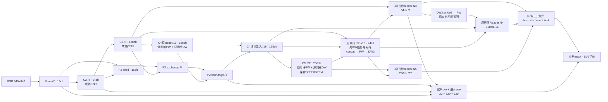

# J7 / CitraSightNet（橘瞳网络，工作名）
日期：2026-10-18。状态：代码、YAML和工程测试已完成；**未完成正式训练，不能称为当前最强模型，也没有涨点或GPU加速结论。**

## 1. 这次为什么这样改
J6 R2六个完整300轮运行中，J90控制Mask AP50–95=63.636%，J94 full=62.577%。部分增强组F1工作点Recall提高，但没有带来AP净增益。训练源码和回传hash核对支持这是真实阴性结果，不支持继续默认“所有分支全开”。
历史证据支持原像素再观察，但不证明浅分支能独立认果。Gemini提出的“先看到、再识别、再筛选”有启发；其奈奎斯特硬阈值、强制蒸馏抬分与圆弧规则不能直接当结论。详细审查在工作目录的gemini_and_local_literature.md和history_grounding.md。

本轮保留早期成熟语义、16ch持续P2、宽Proto与细mask读出；删除新主线中的J6浅scout新增实例、理想GT-ROI训练、source-dependent质量乘法、邻居/收益选择。只让同一个P3/P4/P5实例头负责候选识别。**同源头不是自动校准算法，也不能保证叶果同色问题已解决。**
主线只改变两处：neck的公共语义汇集/原尺度读出；可关闭的C4/C5低网格通道混合。共享塔/删细节/辅助loss另列，不默认叠加。旧quality被物理删除而不只是乘零。

## 2. 架构：主候选J104，不是已知最优
以下通道为scale=n后实际数，输入640×640。C4这里指注入细节后的stage10，C5包含保留的SPPF/C2PSA。



图中exchange/注入是前馈跨层连接，**不是时间递归反馈控制器**。公共语义“一次”仅指新neck中的G，不表示整网只进行一次跨层交互。
N3/N4/N5均有native旁路；P5没有被丢弃。N3→N4是一条明确的语义化返回，N5不读取N4；这是能力取舍，不能说等价于原PAN。

### 精确计算与边界
q_i = Conv1x1(C_i,24)，在各自原网格上投影，再对齐C4尺寸；
G = DW3(PW([Pool(q3),q4,Nearest(q5)]))。
Reader = Conv1x1 → DW3 → Conv1x1（各层BN/SiLU）。
N3=Reader([C3,Up(G)])；
N4=Reader([C4,G,Conv1x1(DW3_stride2(N3))])；
N5=Reader([C5,Pool(G)])。

C4/C5内部可选stage为：
$$F(x)=x+\operatorname{DW}_5(x)+\operatorname{Up}\!\left(W_2\,\phi(W_1\operatorname{AvgPool}_2(x))\right).$$
其中PW宽度c→2c→c，最后PW有BN无激活；早期C2/C3、stage间原步长卷积、SPPF和C2PSA不变。思想参考HIRI-ViT的分辨率/通道运算分工，非完整HIRI复现。
这两次PW原网格主要MAC为4HWc²，半高宽网格为HWc²；额外DW5为25HWc。该简式不计BN/resize/访存，也不等于整网4倍加速。实测J103→J104 GFLOPs仅降约3.56%，且参数略增。

若N3对C5的依赖只经过G，链式导数满足：
$$\operatorname{rank}\!\left(\frac{\partial N_3}{\partial C_5}\right)
\leq\dim(G)=24\times40\times40.$$
这说明低带宽可能损失跨尺度辨别信息，是风险边界，不是“更强识别”的数学证明。640输入已经丢失的原像素，不会由这个公式恢复。

## 3. 十个模型与真实构建成本
|ID|作用|参数(M)|640前向GFLOPs|默认优先|
|---|---|---:|---:|---|
|J100|官方YOLO11n-seg，外部对照|2.842803|10.355763|是|
|J101|旧V12图重放：保留旧route/quality/aux|2.283950|10.601280|否|
|J102|干净成熟锚点：原PAN、独立塔、宽细解码|2.260953|10.504653|是|
|J103|仅将J102的neck替换为24ch公共语义hub|2.207281|9.841664|是|
|J104|在J103基础上仅因子化C4/C5计算|2.220465|9.491046|是|
|J105|J104 + 三尺度共享空间塔，48ch|1.771233|8.515930|否|
|J106|J105共享塔宽度32ch|1.710225|7.837210|否|
|J107|J104去持续P2种子/交换/注入；保留头部C2细化|2.180269|9.172173|否|
|J108|J104去stride2细phase，Proto恢复stride4|2.217104|9.317376|否|
|J109|J104 + 旧tiny Dice .25与可见边界 .5|2.220465|9.491046|否|

由真实完整640输入THOP测量，2 FLOPs/MAC，未融合。包含backbone/neck/三尺度塔/Proto，**不含coeff×Proto掩膜合成、NMS、额外视图、匹配、训练反传**。THOP对部分函数式操作也不完整计数，不能冒充硬件完整指令量。上游summary按stride32外推，可能显示9.7而不是本表9.491；不要混用口径。
J102/J101是保留宽细解码的参考，不满足单图部署GFLOPs上限；J103/104满足前向预算，不代表完整系统一定更轻。
相对同口径J100，J104参数约少21.9%、前向GFLOPs少8.35%；J106约少39.8%、24.3%。**精度未知、实际GPU速度未知**。
J109前向参数不变，但tiny/boundary训练项有额外计算；不是免费损失，也不声称是新loss。
2026-10-19勘误：当前 `ultralytics/utils/loss.py` 实际将 Proto logits 上采样到 GT 尺寸，而非将 GT 降到 Proto 尺寸。因此 mask_ratio=2 时，以上模型的训练 GT/loss 网格一致；J100/J108 的 stride4 原型与 J102–107/109 的 stride2 原型，区别在于独立空间表达带宽，不是训练标签分辨率。J108 同时删除细解码结构，不能归因为纯后处理。EV6 评价 GT 始终 input/2；EV6 对粗原型也先插值到该网格，不能据原生原型面积比宣称 EV6 掩膜合成相差4倍。

## 4. 与文献的关系
- [HIRI-ViT](https://arxiv.org/abs/2403.11999)：借鉴低分网格承担重通道混合，不照搬大分类主干。本轮重读本地方法/消融页，见工作目录。
- [Gold-YOLO](https://arxiv.org/html/2309.11331v1)：已经有gather/fuse/inject及邻尺度增强；本方法不能声称首创公共语义。本图是一次24ch C4 cache+concat reader+短返回，而非其双GD/门控/Transformer。
- [CFPT](https://arxiv.org/html/2407.19696v2)：已经有跨尺度交互和原尺度残差；其分组attention/位置编码不同于本pool/nearest/卷积取舍，不能把简单替换包装成首创。
- [ESOD](https://arxiv.org/abs/2407.16424)：支持“高分浅层负责支持域，不独立完成实例语义”的职责分工。但本轮没有引入它的稀疏切块流程。
旧P2、phase、共享塔等均为继承/适配，不分别硬凑三大创新。当前更合适的定位是**有文献依据的领域架构优化候选**，是否有论文级价值须靠后续结果。

## 5. 直接运行
### 不重训也值得先做的J6诊断
现有eval_citrus_j6.py可对同一J94 best_mask权重运行global/full两种推理。使用J6原运行的相同数据成员和新的输出目录，不要换正式新划分后称为复现：
```bash
python eval_citrus_j6.py --weights /原J94结果/weights/best_mask.pt --data /J6原运行的数据/data.yaml --modes global,full --device 1 --project /结果/J6_same_weight_new
```
这只干预推理，不重训、改标签或改AP。若global也退化，提示训练表示影响；若global不弱而full下降，优先查新增候选/评分/局部链。仍不能直接量化每个组件的因果损失。

### 新J7批量训练
上传整个最新code目录。保留服务器原环境，不安装Mamba/DCN/FFT新依赖。若当前环境尚未指向这个本地包，在主代码目录执行一次`pip install -e .`；不要另装覆盖为纯官方ultralytics后再丢失本地模块。

打开RUN_CITRUS_J7.py，修改：
```python
DATA = "/你的服务器/实际数据集/data.yaml"
DEVICE = "1"
SUITE = "priority"    # 只跑J100/J102/J103/J104
EPOCHS = 300
PROJECT = "/你的服务器/results/J/J7_300EP_新目录"
```
然后在VSCode当前解释器下点右上角三角，或：
```bash
python RUN_CITRUS_J7.py
```
首轮建议EPOCHS=1–3、独立PROJECT检查，再改300和新PROJECT；默认已经300。只构建可用`python RUN_CITRUS_J7.py --dry-run`。想全部10个设置SUITE="all"；不建议在主线未见收益前默认全跑。Ctrl+C停止整个队列，不启动下一个。

**DATA默认是文档要求的grouped_dedup路径，但该目录本地当前不存在。请填写你服务器上真实路径；程序不会偷偷替换为orange_yolo，也不会做指纹/清洗清单确认门。路径名不能证明划分身份，所加载成员仅记录。**
物理DEVICE=1在导入Torch前绑定，进程内显示cuda:0是该物理卡的逻辑编号，不是两张卡一起跑。没有占用保护锁。cache=True按用户要求固定，仍须足够RAM，不能保证全链速度。
已有部分/完整结果不覆盖；相同来源/配置完成记录会跳过，否则提示新PROJECT。若是断电续跑，保留last.pt，本次不自动猜测恢复，不能覆盖重跑。

### 官方单模型API
```python
from ultralytics import YOLO
from citrus_j7_training import J7Trainer
from citrus_j2_batch import settings

model = YOLO("0_orange_yaml/J_V7_series/J104_factored_hub.yaml", task="segment")
model.train(trainer=J7Trainer, data="/实际/data.yaml", device=1,
            project="/results/J7_single", name="J104_seed42", **settings(300, 42))
```
这是原生YOLO.train入口。普通构建、forward、loss、权重保存加载均已注册；指定J7Trainer是为保持I/J的EV6评价，不是baseline COCO评估器。
固定协议：AdamW .001/lrf.01/decay.0005、AMPFalse、scratch、640、maskratio2、batch16、workers4、dropout0、copy_paste.3、mosaic1、hsv(.015,.7,.4)、scale.5、translate.1、fliplr.5、mixup0、close_mosaic10、deterministicTrue、seed42。batch/worker可显式改，但同组对照需共同改；OOM不会偷偷减batch继续。

## 6. PR与选轮：以后看这些文件
训练每轮仍EV6。最终指标、曲线和返回模型统一来自weights/best_mask.pt（Mask AP50–95选轮），原best.pt（box+mask fitness）不删除、不冒充best-mask。
每个模型的selected_mask_validation/包含：
- selected_checkpoint.json：选轮、checkpoint SHA、最终指标；
- MaskPR_curve.png等原生图（plotsTrue且环境可用）；
- mask_pr_audit.json：不插值的真实Rmax、R@P90/95、末20个置信阈值组TP/FP；
- raw_mask_matches.npz：现成匹配位与分数，无重匹配/改AP。

PR横轴是召回率。Rmax之后的补零不是“confidence=.85时精度突然为零”，更不是靠画图函数能解决的模型故障。真实漏检与尾部FP需上面数据判断；当前没有承诺消除所有补零。
这个PR审计不是按对象尺寸/叶片身份的诊断，不能单独证明小果或漏标原因，也不提供统计置信区间。测试部署阈值须先在val固定。

本地Matplotlib/NumPy不兼容，所以工程smoke显式plotsFalse。生产仍True，程序在训练前小图预检，失败不会默默关闭绘图后继续300轮。CPU工程通过不等于服务器环境已验证。

## 7. 速度不能只看GFLOPs
默认原生预测在相同N下，J104的320²原型主要mask组合相对J100的160²约4倍；EV6先将原型统一到input/2，因此其评价路径两者都320²。不要混用两个执行链的AP/时间。
benchmark_citrus_j7.py可在训练后用同一批预加载真实图测官方native predict完整调用：
```bash
python benchmark_citrus_j7.py --weights /结果/J100/weights/best_mask.pt /结果/J104/weights/best_mask.pt --source /实际/val/images --device 1 --output /结果/J7_native_latency_new.json
```
固定batch1、640、rectFalse、halfFalse、conf.001、maxdet300；GPU前后同步，记录总wall median/p95、NMS后待解码数及空mask过滤后返回数、分段profile。返回0个不等于未执行mask组合。不含磁盘IO、加载热身、输出mask搬CPU、匹配AP；这不是EV6验证同链延迟。无GPU的本机只做程序连通性检查，不提供GPU速度预测。

## 8. 已验证与未完成
已完成：120项聚焦/回归测试通过，覆盖全部10 YAML构建/标准合成分割batch上的实际loss前反向/矩形eval/空标注/有效tiny边界项/无quality调用/共享参数AdamW与EMA/fuse及官方保存加载。真实4张副本一轮训练、缓存、checkpoint和EV6终评完成；新增PR审计集成完成。原标签和原结果未动。
未完成：服务器Python3.8/Torch1.13/CUDA实跑、生产绘图、正式精度、完整GPU时延、三seed/独立test、新结构必要性证明。不能宣称“已经涨点”或“最强终稿”。

主实验：先4核心300轮，返回结果后才决定105–109。见工作目录refine-logs/EXPERIMENT_PLAN.md。
